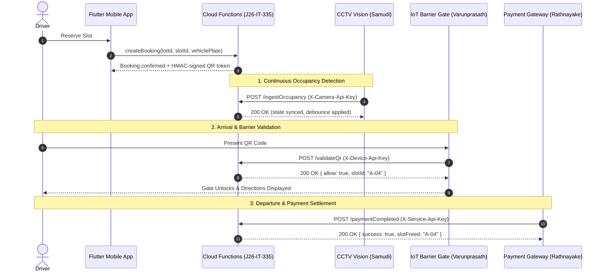

# Smart Parking System (SPS) — Component Integration Contracts
**Project Reference**: SLIIT Final Year Research J26-IT-335  
**Component**: Dynamic Slot Re-optimization & Reservation Model (Lead: Anuk)  
**Collaborating Subsystems**:
1. **Vision Occupancy Detection Model / CCTV** (Samudi)
2. **IoT Barrier Gate & Indoor Guidance** (Varunprasath)
3. **Smart Billing & Payment Gateway** (Rathnayake)

---

## 1. System Overview & Security Architecture

All external hardware and microservices communicate with the central reservation server via **authenticated HTTPS endpoints** (`POST`). Direct database writes by external hardware are strictly forbidden by Firestore Security Rules.



### 1.1 Device Authentication & API Key Hashing
Every hardware unit or external service is registered in the Firestore `/devices/{deviceId}` collection:

```json
{
  "id": "cam-lot-main-01",
  "name": "Overhead Camera Bay A1-A6",
  "type": "camera", // "camera" | "barrier" | "payment_gateway"
  "lotId": "lot-main",
  "slotId": null, // or specific bay ID e.g. "A-04" for dedicated bay barriers
  "apiKeyHash": "e3b0c44298fc1c149afbf4c8996fb92427ae41e4649b934ca495991b7852b855", // SHA-256(API_KEY)
  "isActive": true,
  "lastSeenAt": "2026-10-19T14:30:00.000Z"
}
```

When an external request arrives, the server hashes the provided API key using SHA-256 and validates it against the active device record.

---

## 2. CCTV Occupancy Detection Contract

### Endpoint
`POST https://<region>-<project-id>.cloudfunctions.net/ingestOccupancy`  
Local Emulator: `http://127.0.0.1:5001/<project-id>/us-central1/ingestOccupancy`

### Headers
| Header | Type | Description |
| :--- | :--- | :--- |
| `Content-Type` | `application/json` | Required `application/json` |
| `X-Camera-Api-Key` | `string` | Secret API key allocated to the camera |

### Request Payload
```json
{
  "lotId": "lot-main",
  "slotId": "A-04",
  "occupied": true,
  "confidence": 0.94,
  "timestamp": "2026-10-19T14:32:00.000Z",
  "violation": false
}
```

### Fields
| Field | Type | Required | Description |
| :--- | :--- | :--- | :--- |
| `lotId` | `string` | Yes | Target parking lot ID |
| `slotId` | `string` | Yes | Specific slot/bay identifier (e.g., `A-04`) |
| `occupied` | `boolean` | Yes | `true` if camera vision model detects vehicle in bay |
| `confidence` | `number` | Yes | Vision confidence score $[0.0, 1.0]$. Readings $< 0.70$ are discarded. |
| `timestamp` | `string` | Yes | ISO-8601 capture timestamp. Packets older than `slot.lastCctvAt` are discarded. |
| `violation` | `boolean` | No | Optional flag indicating parking violation (e.g., double-parked, crooked) |

### Debounce & Synchronization Rules
1. **Debounce (30 Seconds)**: To prevent flickering from occlusion, passing pedestrians, or reflections, state transitions (`available` $\leftrightarrow$ `occupied`) only commit when the reading remains consistent for $\ge 30\text{ seconds}$.
2. **Conflict Resolution & Algorithmic Re-allocation**:
   - If CCTV detects `occupied: true` on a slot whose state is `reserved` or `held` but the driver has **not** checked in (`checkedInAt == null`):
     - An unauthorized vehicle has entered the reserved bay.
     - The slot remains `reserved` with `conflictFlag: true`.
     - The system immediately triggers **Dynamic Slot Re-allocation**:
       - Runs the multi-criteria scoring engine to find the next best available slot in the same lot.
       - Reallocates the booking to the candidate slot.
       - Rotates the driver's HMAC-signed QR token for the new slot.
       - Logs `reallocated_due_to_conflict` event and creates an urgent alert in `/admin_alerts`.
3. **Vacated Without Payment**:
   - If CCTV reports `occupied: false` on a slot where booking status is `checkedIn`:
     - The slot is **not** freed.
     - The system emits a `vacated_without_payment` event and notifies security via `/admin_alerts`.

### Success Response (`200 OK`)
```json
{
  "success": true,
  "slotId": "A-04",
  "state": "occupied",
  "conflictDetected": false,
  "debounceStatus": "applied",
  "timestamp": "2026-10-19T14:32:31.000Z"
}
```

### Conflict Detected Response (`200 OK`)
```json
{
  "success": true,
  "slotId": "A-04",
  "state": "reserved",
  "conflictDetected": true,
  "reallocated": true,
  "reallocatedToSlotId": "B-02",
  "alertId": "ALT-1792420000",
  "message": "Unauthorized vehicle detected in reserved bay. Booking automatically reallocated."
}
```

---

## 3. IoT Barrier Gate QR Validation Contract

### Endpoint
`POST https://<region>-<project-id>.cloudfunctions.net/validateQr`  
Local Emulator: `http://127.0.0.1:5001/<project-id>/us-central1/validateQr`

### Headers
| Header | Type | Description |
| :--- | :--- | :--- |
| `Content-Type` | `application/json` | Required `application/json` |
| `X-Device-Api-Key` | `string` | Secret API key registered for the barrier controller |

### Request Payload
```json
{
  "qrToken": "SPS.v1.BK-1001.A-04.1792420000.1792420900.7f8b9a.e9b4c02f1a8c...",
  "barrierId": "GATE-ENTRY-01"
}
```

### Cryptographic Token Format
Tokens generated by the reservation authority follow the tamper-proof format:
`SPS.<version>.<bookingId>.<slotId>.<validFromEpochSec>.<validUntilEpochSec>.<nonce>.<hmacSha256Signature>`

### Validation Rules
1. **Signature Verification**: Verified server-side via `crypto.timingSafeEqual` against the server's Secret Manager HMAC key.
2. **Device Geofencing**: The device registered as `barrierId` must belong to the same `lotId` as the booking. If the barrier controls a specific bay, `slotId` must match the token. Mismatches return code `WRONG_SLOT`.
3. **Time-Window**: Tokens are valid only between $\text{arrivalTime} - 30\text{ min}$ and $\text{holdExpiresAt}$.
4. **Single-Use**: Once validated, the booking transitions to `checkedIn` and records `checkedInAt`. Replaying the token returns `TOKEN_ALREADY_USED`.
5. **Upgrade Rotation**: When an in-transit upgrade is accepted, the previous QR token is invalidated and replaced with a newly signed token.

### Success Response (`200 OK`)
```json
{
  "allow": true,
  "bookingId": "BK-1001",
  "lotId": "lot-main",
  "slotId": "A-04",
  "driverName": "Anuk Cooray",
  "vehiclePlate": "CAB-4821",
  "message": "Verification confirmed. Barrier unlocking."
}
```

### Rejection Response (`403 Forbidden` / `200 OK with allow: false`)
```json
{
  "allow": false,
  "code": "WRONG_SLOT",
  "reason": "Token is for Bay A-04, but barrier controls Bay B-01.",
  "bookingId": "BK-1001"
}
```

---

## 4. Smart Billing & Payment Settlement Contract

### Endpoint
`POST https://<region>-<project-id>.cloudfunctions.net/paymentCompleted`  
Local Emulator: `http://127.0.0.1:5001/<project-id>/us-central1/paymentCompleted`

### Headers
| Header | Type | Description |
| :--- | :--- | :--- |
| `Content-Type` | `application/json` | Required `application/json` |
| `X-Service-Api-Key` | `string` | Secret API key allocated to the payment service |

### Charges Exposure on Booking Document
Every booking document `/bookings/{bookingId}` exposes an authoritative `charges` array maintained solely by the server:

```json
{
  "id": "BK-1001",
  "status": "checkedIn",
  "charges": [
    {
      "id": "CHG-1001-BASE",
      "type": "parking",
      "amount": 100,
      "currency": "LKR",
      "timestamp": "2026-10-19T14:00:00.000Z",
      "description": "Base reservation (1 hour at LKR 100/hr)"
    },
    {
      "id": "CHG-1001-EXT-1",
      "type": "extension",
      "amount": 50,
      "currency": "LKR",
      "timestamp": "2026-10-19T14:15:00.000Z",
      "description": "15-minute arrival hold extension fee"
    }
  ]
}
```

### Request Payload
```json
{
  "bookingId": "BK-1001",
  "paymentRef": "LANKAQR-TXN-99881234",
  "amountPaid": 150,
  "paymentMethod": "qr_pay",
  "timestamp": "2026-10-19T15:20:00.000Z"
}
```

### Settlement Rules
1. **Idempotency**: Requests are keyed on `paymentRef` in `/processed_payments/{paymentRef}`. Re-sending an identical reference returns the initial receipt without double-crediting or re-incrementing counters.
2. **Server-Side Final Calculation**: Upon exit, final parking charge is computed based on elapsed time between `checkedInAt` and exit timestamp (rounded up to the lot's billing block, e.g. 1 hour).
3. **Atomic Slot Freeing**: When settled, booking status transitions to `completed`, the slot transitions to `available`, `bookingId` is cleared, and `freeSlots` is incremented.

### Success Response (`200 OK`)
```json
{
  "success": true,
  "bookingId": "BK-1001",
  "paymentRef": "LANKAQR-TXN-99881234",
  "totalCharged": 150,
  "amountPaid": 150,
  "status": "completed",
  "slotFreed": "A-04",
  "receiptNo": "REC-1792420800-BK-1001"
}
```

---

## 5. Comprehensive Error Codes Table

| HTTP Status | Error Code | Component | Description & Resolution |
| :---: | :--- | :---: | :--- |
| `401` | `INVALID_API_KEY` | All | Provided `X-Camera-Api-Key`, `X-Device-Api-Key`, or `X-Service-Api-Key` does not match any registered device in Firestore `/devices`. Verify key. |
| `400` | `INVALID_PAYLOAD` | All | Payload failed JSON schema validation (missing required fields, malformed timestamp). |
| `404` | `LOT_NOT_FOUND` | CCTV / Barrier | Specified `lotId` does not exist in the database. |
| `404` | `SLOT_NOT_FOUND` | CCTV / Barrier | Specified `slotId` does not exist in the lot's subcollection `/slots/{slotId}`. |
| `404` | `BOOKING_NOT_FOUND` | Barrier / Payment | Specified `bookingId` does not exist in `/bookings/{bookingId}`. |
| `400` | `LOW_CONFIDENCE` | CCTV | Camera vision detection confidence is $< 0.70$. Packet ignored. |
| `400` | `OUTDATED_PACKET` | CCTV | Packet timestamp is older than `slot.lastCctvAt`. Packet dropped. |
| `403` | `INVALID_SIGNATURE` | Barrier | HMAC token signature failed cryptographic verification (tampered token or secret mismatch). |
| `403` | `WRONG_SLOT` | Barrier | Barrier device is mapped to a different bay or lot than the one indicated in the driver's QR token. |
| `403` | `EXPIRED_OR_PREMATURE` | Barrier | Current time is outside the valid arrival/hold window. |
| `403` | `TOKEN_ALREADY_USED` | Barrier | Driver has already checked in with this token. Single-use policy enforced. |
| `403` | `BOOKING_INACTIVE` | Barrier | The booking has been cancelled or auto-released due to elapsed hold time. |
| `400` | `INSUFFICIENT_PAYMENT` | Payment | `amountPaid` is less than the accumulated `charges` total. |
| `409` | `ALREADY_SETTLED` | Payment | The booking has already been paid and completed with a different payment reference. |

---

## 6. Testing with Postman & Emulators

A complete Postman collection is provided at:  
[`docs/sps-integration.postman_collection.json`](file:///c:/Users/indee/Desktop/App/docs/sps-integration.postman_collection.json)

### Pre-seeded Test Credentials (Emulator Only)
| Subsystem | Header | Value | Device ID |
| :--- | :--- | :--- | :--- |
| **CCTV Vision** | `X-Camera-Api-Key` | `cctv-secret-key-cam-01` | `cam-lot-main-01` |
| **IoT Barrier** | `X-Device-Api-Key` | `barrier-secret-key-gate-01` | `barrier-gate-entry-01` |
| **Payment Gateway** | `X-Service-Api-Key` | `payment-secret-key-svc-01` | `payment-gateway-svc-01` |
